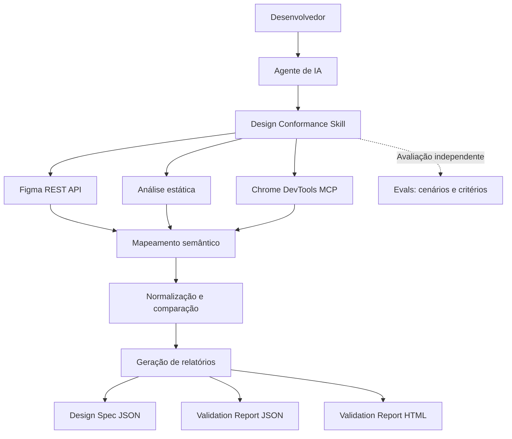

# Design Conformance

Agent Skill para validar a conformidade visual entre um design no Figma e sua implementação em uma aplicação web.

A solução combina extração de especificações pela Figma REST API, análise estática de código e inspeção da interface em execução pelo Chrome DevTools MCP. O objetivo é identificar divergências relevantes e acompanhar a evolução da conformidade da tela ao longo das rodadas de validação.

## Como funciona



O agente de IA interpreta as instruções da Skill, coordena as ferramentas e associa os elementos do design aos componentes da aplicação. Os scripts JavaScript executam as operações determinísticas de extração, normalização, comparação e geração de relatórios.

## O que é validado

| Categoria | Propriedades |
| --- | --- |
| Tipografia | Família de fontes declarada, tamanho, peso, altura da linha e alinhamento, quando comparáveis |
| Cores | Cores sólidas de texto e fundo |
| Espaçamento | Padding por lado e gaps explícitos de Auto Layout |
| Bordas | Propriedades de borda comparáveis |
| Layout | Alinhamento e dimensões explicitamente fixas |

A validação considera a tela como um todo, respeitando o viewport, o estado da interface e a correspondência entre elementos. Conteúdos dinâmicos, como mensagens, nomes, horários e valores de exemplo, não são comparados literalmente.

Uma propriedade sem evidência suficiente é classificada como inconclusiva, e não como conforme ou divergente.

## Estrutura da Skill

```text
design-conformance/
├── SKILL.md
├── references/
│   ├── validation-rules.md
│   ├── design-extraction.md
│   ├── static-validation.md
│   ├── runtime-validation.md
│   └── element-matching.md
├── scripts/
│   ├── extract-design.cjs
│   ├── inspect-runtime.cjs
│   ├── normalize.cjs
│   ├── compare.cjs
│   └── generate-report.cjs
├── templates/
│   ├── design-spec.json
│   └── validation-report.html
├── evals/
│   └── evals.json
└──
```

- `SKILL.md`: ponto de entrada e instruções de orquestração.
- `references/`: regras e orientações de cada etapa da validação.
- `scripts/`: operações JavaScript executadas com Node.js; a função de inspeção runtime é enviada ao navegador pelo agente via MCP.
- `templates/`: modelo de especificações e template do relatório HTML.

## Pré-requisitos

- Node.js 22 ou superior.
- Agente de IA com suporte a Agent Skills e acesso ao repositório.
- Chrome DevTools MCP configurado e autorizado no agente.
- Token de acesso à Figma REST API com permissão `file_content:read` e acesso ao arquivo desejado.

## Instalação

Copie a pasta da Skill, incluindo o `SKILL.md` e seus subdiretórios, para o repositório da aplicação:

```text
meu-projeto/
├── .agents/
│   └── skills/
│       └── design-conformance/
│           ├── SKILL.md
│           ├── references/
│           ├── scripts/
│           └── templates/
└── src/
```

Confirme que o diretório de Skills é reconhecido pela versão do agente utilizada.

Disponibilize `FIGMA_TOKEN` no ambiente do processo de extração ou em um arquivo `.env` local autorizado:

```dotenv
FIGMA_TOKEN=seu_token_aqui
```

Não versione o `.env`, não inclua tokens no prompt e não publique credenciais nos relatórios.

## Utilização

Abra o agente de IA na raiz do repositório da aplicação e solicite o uso da Skill. Caso a instalação disponibilize um comando de invocação, utilize `/design-conformance`.

Exemplo de solicitação:

```text
Utilize a skill design-conformance para validar a tela Praticar.

Figma: <link do frame com node-id>
Aplicação: <URL da tela>

Realize a análise estática do código-fonte e a validação runtime.
Gere os relatórios sem modificar o código-fonte da aplicação.
```

A aplicação pode estar disponível em localhost ou em uma URL publicada. Quando a aplicação local não estiver rodando, o agente deve identificar o comando de inicialização do projeto e solicitar autorização antes de executá-lo. Não é necessário iniciar manualmente a aplicação nesse cenário, desde que o agente tenha acesso ao ambiente e permissão para executar o comando.

A análise estática é realizada diretamente no código-fonte do repositório em que a Skill está instalada.

## Relatórios e histórico

Os artefatos são gerados na raiz do repositório da aplicação:

```text
artifacts/
└── praticar/
    ├── v001_21-11-26/
    │   ├── design-spec.json
    │   ├── validation-report.json
    │   └── validation-report.html
    ├── v002_21-11-26/
    │   ├── design-spec.json
    │   ├── validation-report.json
    │   └── validation-report.html
    └── v003_22-11-26/
        ├── design-spec.json
        ├── validation-report.json
        └── validation-report.html
```

| Arquivo | Responsabilidade |
| --- | --- |
| `design-spec.json` | Especificações extraídas do frame do Figma. |
| `validation-report.json` | Resultado estruturado, evidências, metadados e histórico das validações. |
| `validation-report.html` | Relatório visual em dark mode para consulta no navegador. |

O versionamento é contínuo por tela, no formato `vNNN_DD-MM-AA`. A contagem não reinicia quando a data muda. Execuções anteriores não são sobrescritas; execuções incompletas podem deixar lacunas na numeração e não contam como rodadas concluídas.

### Design Conformance Report

O relatório HTML apresenta:

- Quantidade de elementos, verificações e divergências.
- Percentual e barra de conformidade, com indicação de verificações inconclusivas.
- Histórico das rodadas e gráfico de evolução das divergências.
- Divergências resolvidas, persistentes e novas entre rodadas comparáveis.
- Divergências agrupadas por categoria.
- Tabela com componente, propriedade, valor esperado no Figma e valor observado na aplicação.
- Cobertura, limitações e evidências da análise estática.

O percentual de conformidade é calculado somente sobre verificações conclusivas: `conformes / (conformes + divergentes) × 100`. Quando não há verificações conclusivas, o percentual não é apresentado como zero ou cem por cento.

Uma divergência só é considerada resolvida quando a mesma verificação, em contexto equivalente, passa de divergente para conforme. A ausência de evidência não comprova uma correção. O histórico ajuda a identificar retrabalho e dificuldades recorrentes, mas não mede produtividade individual.

## Evals

Os cenários em `evals/evals.json` avaliam a aderência do agente ao protocolo, a precisão, a cobertura e a segurança. Execute manualmente em ambiente controlado, fora do fluxo operacional do desenvolvedor, e registre evidências de cada critério. O JSON não é um executor automático. Análise estática e runtime são obrigatórias; impedimentos devem ser explicitados e não permitem aprovação integral.

## Segurança

A Skill deve operar em modo de inspeção, sem alterar o código-fonte, instalar dependências, realizar operações de negócio ou encerrar processos iniciados pelo desenvolvedor. O acesso a páginas autenticadas depende de autorização. O token do Figma deve ser utilizado exclusivamente pelo processo de extração e nunca exposto ao agente ou aos relatórios.

## Limitações e status

A solução está em fase de homologação integrada com Figma REST API e Chrome DevTools MCP. A compatibilidade com cada agente depende do suporte a Agent Skills e das ferramentas e permissões disponíveis no ambiente.

## Referências

- [Agent Skills](https://agentskills.io/)
- [Figma REST API](https://developers.figma.com/docs/rest-api/)
- [Chrome DevTools MCP](https://github.com/ChromeDevTools/chrome-devtools-mcp)
- [Node.js](https://nodejs.org/docs/latest-v22.x/api/)
